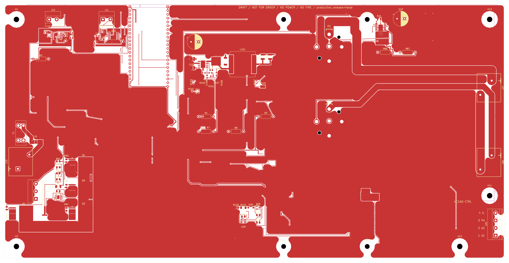
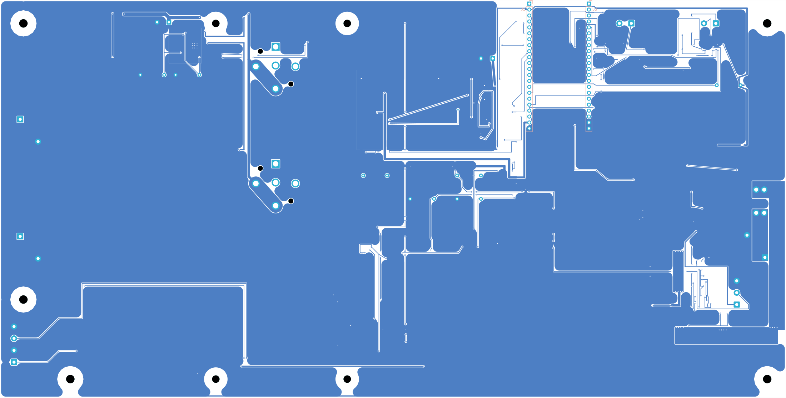

# Sirokko 262.01 controller

> **DRAFT / NOT FOR ORDER / NO POWER / NO FLASH / NO FIRE.** The board is unfinished, has no manufacturing release, and has not passed physical acceptance. Do not order it, power it, flash it, or connect it to a burner.

The working tree contains one current KiCad project:

- project: [`hardware/kicad/Sirokko26201_control_motor_candidate.kicad_pro`](hardware/kicad/Sirokko26201_control_motor_candidate.kicad_pro);
- schematic: [`hardware/kicad/Sirokko26201_control_motor_candidate.kicad_sch`](hardware/kicad/Sirokko26201_control_motor_candidate.kicad_sch);
- PCB: [`hardware/kicad/Sirokko26201_control_motor_candidate.kicad_pcb`](hardware/kicad/Sirokko26201_control_motor_candidate.kicad_pcb);
- current schematic SHA-256: `2279ad71b4287f330ffd061f1218d8d945e80ca9d2caefb1292faf162a9a3bdd`;
- current PCB SHA-256: `6ea5b392561a2a3ee505dbe6bb78ba373edfd27e1a791477c14c460238b4a169`.

The display, local Start/Stop button, rotary encoder, their dedicated circuitry, PCB footprints, copper and display mounting holes are removed by the latest direct requirement. Six released ESP pins are marked NC. The main PCB is synchronized with the current schematic. Control, settings and diagnostics are now required only through a software remote interface implemented by the ESP32; the protocol and firmware are not yet accepted or implemented.

Fresh KiCad 10.0.7 checks with all DRC rules enabled and `ignored_checks=[]` report ERC=0 and DRC=0 errors, 0 warnings, 0 unconnected items and 0 PCB↔schematic parity differences. All 2703 previously connected physical pad pairs remain connected. The board is two-layer, with 347 pads, 897 track segments and 261 vias. These are CAD geometry and connectivity checks, not electrical, thermal or manufacturing acceptance. See [`hardware/kicad/ALL_RULES_AUDIT_RU.md`](hardware/kicad/ALL_RULES_AUDIT_RU.md) and [`hardware/kicad/PCB_REVIEW_RU.md`](hardware/kicad/PCB_REVIEW_RU.md) for the exact scope and limitations.

This metadata revision adds the Phoenix Contact J29 part number `1715747`, manufacturer and datasheet to the schematic and PCB. It does not establish the electrical compatibility of HC-160A inputs with 3.3 V GPIO or qualify the external motor module.

## Current PCB views — WIP / DRAFT

Front view (not a 3D render or assembly drawing):

Back view (not a 3D render or assembly drawing):

Current documents:

- [`docs/REQUIREMENTS_RU.md`](docs/REQUIREMENTS_RU.md) — current product requirements;
- [`docs/CURRENT_STATE_RU.md`](docs/CURRENT_STATE_RU.md) — current state and limitations;
- [`hardware/kicad/REMOTE_ONLY_REQUIREMENTS_RU.md`](hardware/kicad/REMOTE_ONLY_REQUIREMENTS_RU.md) — remote-only control contract;
- [`hardware/kicad/ELECTRICAL_INTERFACE_RU.md`](hardware/kicad/ELECTRICAL_INTERFACE_RU.md) — verified connection table, relay logic and interface limitations;
- [`docs/BOM_DRAFT_NOT_FOR_ORDER.csv`](docs/BOM_DRAFT_NOT_FOR_ORDER.csv) — KiCad CSV BOM with MPN for 79 schematic instances; draft, not an orderable procurement BOM;
- [`hardware/kicad/PCB_REVIEW_RU.md`](hardware/kicad/PCB_REVIEW_RU.md) — current PCB verification and remaining acceptance work;
- [`hardware/kicad/README.md`](hardware/kicad/README.md) — project entry points and local dependencies;
- [`manufacturing/DRAFT_NOT_FOR_ORDER/`](manufacturing/DRAFT_NOT_FOR_ORDER/) — preliminary Gerber, drill, BOM and placement outputs; **DRAFT / NOT FOR ORDER / NO POWER / NO FLASH / NO FIRE**.

There is no approved firmware for this hardware contract. Firmware work remains blocked until the final remote-control contract and hardware acceptance are complete. Electrical and thermal acceptance and the manufacturing release remain unfinished; the preliminary manufacturing outputs above are not a release or permission to order, assemble, power, flash or operate the board.

Revision copies, verification reports, renders, snapshots and archives are not kept beside the sources. Normal Git history is the only recovery path for earlier states.
