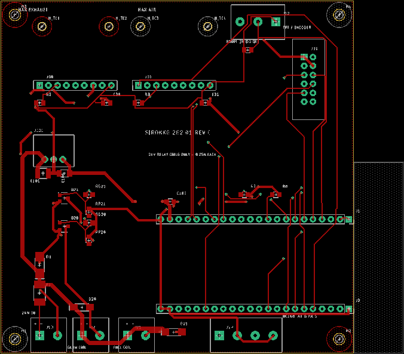

# Sirokko 262.01

Контроллер отопителя Sirokko 262.01 на ESP32-S3. Управляет розжигом, муфтой топливного насоса и вентилятором, поддерживает температуру помещения. Управление — с TFT-панели с энкодером или из браузера по Wi-Fi.

[Скачать прошивку](https://github.com/krolbot/sirokko-26201-controller/releases/latest/download/Sirokko-firmware.zip) · [Руководство пользователя](docs/user-guide.md) · [Схема PDF](hardware/schematic.pdf)

## Возможности

- Розжиг, контроль температур и охлаждающая продувка после остановки.
- Ручное управление и поддержание температуры помещения, таймер отключения.
- Две термопары K через MAX31856 и комнатный датчик DS18B20.
- TFT 2,4″ с энкодером EC11 и кнопкой пуска/остановки; веб-интерфейс на русском языке.
- Подписанные обновления прошивки по Wi-Fi.

Питание — **24 В DC**; преобразователь **24 → 5 В находится на плате**. Два внешних автомобильных реле включают свечу и муфту: плата питает только их катушки, силовые контакты подключаются отдельными проводами. Двигатель подключается через внешний регулятор **HC-160A S2**. Используется модуль **YD-ESP32-S3 N16R8 V1.4**.

Проект не испытывался на реальном оборудовании.

## Плата и компоненты

[Ведомость компонентов](hardware/BOM.md) содержит номиналы, артикулы, количества и требования к внешним модулям. Есть [CSV](hardware/bom.csv) для закупки. Подключения, распиновки и порядок монтажа — в [инструкции сборки](docs/assembly.md).

Производственные файлы и статус ревизии описаны в [manufacturing/README.md](manufacturing/README.md).

## Прошивка

[Готовый USB-комплект](https://github.com/krolbot/sirokko-26201-controller/releases/latest/download/Sirokko-firmware.zip) включает загрузчик, таблицу разделов и приложение. [Руководство](docs/user-guide.md) описывает запись, первоначальную настройку и управление. Перед первым запуском задайте параметры отопителя по руководству.

Для сборки из исходников нужны ESP-IDF **5.2.3** и Node.js **26**. Команды сборки и подписи OTA — в [firmware/README.md](firmware/README.md).

## Файлы проекта

- [hardware/](hardware/) — схема и плата Fusion Electronics в формате EAGLE (.sch / .brd), PDF и компоненты.
- [firmware/](firmware/) — прошивка ESP32-S3 и веб-интерфейс.
- [manufacturing/](manufacturing/) — Gerber, сверловка, BOM и координаты для монтажа.
- [docs/](docs/) — сборка, подключение и руководство пользователя.

[Все файлы выпуска](https://github.com/krolbot/sirokko-26201-controller/releases/latest) · [Сообщить о проблеме](https://github.com/krolbot/sirokko-26201-controller/issues)

## Лицензии

Общая лицензия не назначена. Лицензии сторонних материалов: [исходные библиотеки KiCad](hardware/KICAD_LIBRARIES_LICENSE.md), [прошивка](firmware/third_party/README.md), [веб-интерфейс](firmware/web_ui/THIRD_PARTY_NOTICES.txt).
