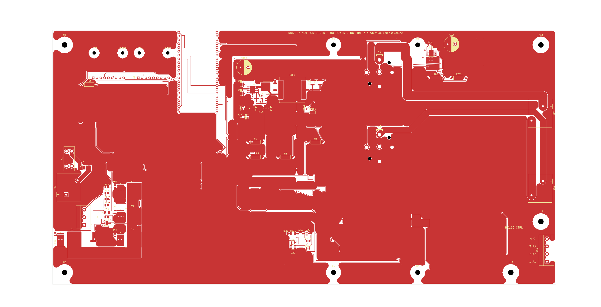
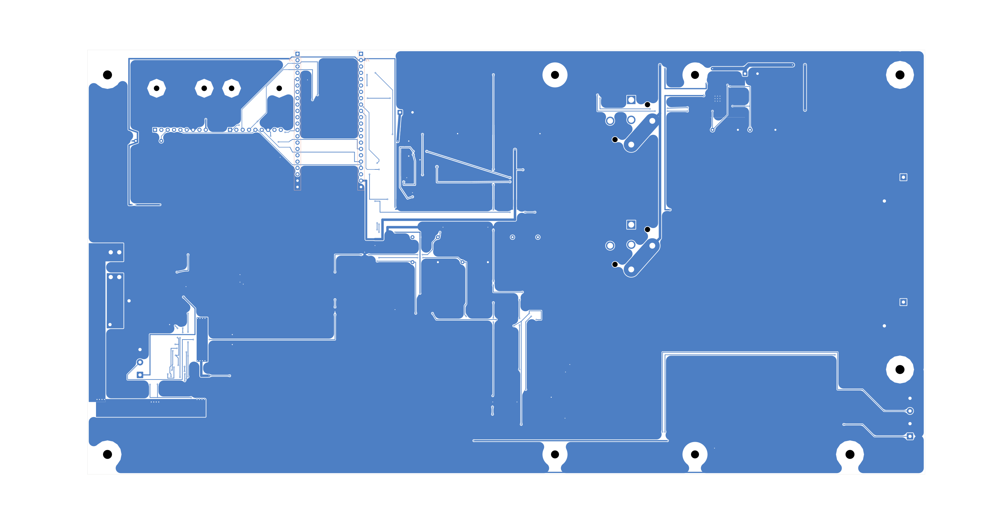

# Sirokko 262.01 controller

> **DRAFT / NOT FOR ORDER / NO POWER / NO FLASH / NO FIRE; firmware HOLD.** The board is unfinished, has no manufacturing release, and has not passed physical acceptance. Do not order it, power it, flash it, or connect it to a burner. The schematic and PCB now contain the selected removable MAX31856 modules and pass the current CAD parity checks. The tracked manufacturing package is still the preceding discrete-MAX31856 draft and does not match the current PCB.

The working tree contains one intentionally incomplete KiCad WIP:

- project: [`hardware/kicad/Sirokko26201_control_motor_candidate.kicad_pro`](hardware/kicad/Sirokko26201_control_motor_candidate.kicad_pro);
- schematic: [`hardware/kicad/Sirokko26201_control_motor_candidate.kicad_sch`](hardware/kicad/Sirokko26201_control_motor_candidate.kicad_sch);
- PCB: [`hardware/kicad/Sirokko26201_control_motor_candidate.kicad_pcb`](hardware/kicad/Sirokko26201_control_motor_candidate.kicad_pcb);
- current schematic SHA-256: `cd57f2f4cb95d1837588f269e49d26bc122facc66959b843bc91a59548b22ec4`;
- current PCB SHA-256: `efdae16f81208a62a88358b7bf35f454e072378b686593ecc42d9b9f1dcfb700`;
- current power-sheet SHA-256: `36248b3d5b1e4c93b9551ad1ab19b3abd59f357226a311998b310b7e8ac1514d`.

The latest product decision selects two removable blue MAX31856 modules from <https://ozon.ru/t/3QtIbaX> instead of the on-board U9/U10 circuits. The exact module is not MAX31865. The user accepted the official Adafruit 3263 Eagle geometry as the documented basis for these visually identical modules. The schematic and PCB now implement J30/J31 on a shared SPI bus with separate CS and DRDY signals; FLT and `3Vo` are NC, and VIN is connected to +3V3. The PCB includes four mounting points, copper keepouts and routed module nets. Socket MPN/footprint assignment, final height stack, full mechanical acceptance, BOM and CAM remain unfinished.

The display, local Start/Stop button, rotary encoder, their dedicated circuitry, PCB footprints, copper and display mounting holes are removed by the latest direct requirement. Six released ESP pins are marked NC. Control, settings and diagnostics are now required only through the ESP32 access point and browser panel; the firmware is not yet implemented and remains on HOLD.

The current revision keeps K1 for the glow plug and K2 for the clutch. K3 and R703 are removed; K2.87 connects directly to J28.1. GPIO21/MCU_PERMIT is now NC, while GPIO18 remains NC. The change and its safety limitation are recorded in [`hardware/kicad/SIROKKO_TWO_RELAYS_CHANGE_RU.md`](hardware/kicad/SIROKKO_TWO_RELAYS_CHANGE_RU.md).

Fresh KiCad 10.0.7 checks of the modular pair report ERC=0 and DRC=0 with 0 unconnected items and 0 schematic-parity differences. DRC has `ignored_checks=[]`; ERC retains four named standard ignored classes and adds none. The PCB has 78 footprints, 308 pads, 748 track segments, 210 vias and 27 zones. Positive connectivity covers all 18 J30/J31 pins; two independent negative mutations were detected. These are CAD checks, not electrical, thermal, mechanical or manufacturing acceptance.

Current C104 is Murata `GRM1885C1H222JA01D`, 2.2 nF, 50 V, C0G, ±5%. The accepted change and its limits are documented in [`docs/research/C104_BOOTSTRAP_REVIEW_RU.md`](docs/research/C104_BOOTSTRAP_REVIEW_RU.md); it is not a physical qualification or manufacturing approval.

The preceding discrete draft connects each MAX31856 BIAS output to T− and makes C9/C14 the 0.1 µF differential capacitors between T− and T+. Its source-grounded review remains [`docs/research/THERMOCOUPLE_BIAS_CORRECTION_RU.md`](docs/research/THERMOCOUPLE_BIAS_CORRECTION_RU.md). The exact schematic replacement is recorded in [`docs/research/MAX31856_MODULE_SCHEMATIC_INTEGRATION_RU.md`](docs/research/MAX31856_MODULE_SCHEMATIC_INTEGRATION_RU.md), and the current routing and its limits are recorded in [`docs/research/MAX31856_MODULE_PCB_INTEGRATION_RU.md`](docs/research/MAX31856_MODULE_PCB_INTEGRATION_RU.md). The five-sheet overview is [`docs/Sirokko26201_control_motor_candidate_DRAFT.pdf`](docs/Sirokko26201_control_motor_candidate_DRAFT.pdf). Older discrete files remain historical evidence, not acceptance of the current module construction.

## Current PCB views — WIP / DRAFT

Front view (not a 3D render or assembly drawing):

Back view (not a 3D render or assembly drawing):

Current documents:

- [`docs/REQUIREMENTS_RU.md`](docs/REQUIREMENTS_RU.md) — current product requirements;
- [`docs/CURRENT_STATE_RU.md`](docs/CURRENT_STATE_RU.md) — current state and limitations;
- [`hardware/kicad/REMOTE_ONLY_REQUIREMENTS_RU.md`](hardware/kicad/REMOTE_ONLY_REQUIREMENTS_RU.md) — remote-only control contract;
- [`hardware/kicad/ELECTRICAL_INTERFACE_RU.md`](hardware/kicad/ELECTRICAL_INTERFACE_RU.md) — verified connection table, relay logic and interface limitations;
- [`hardware/kicad/YD_V14_ELECTRICAL_INTEGRATION_RU.md`](hardware/kicad/YD_V14_ELECTRICAL_INTEGRATION_RU.md) — verified YD V1.4 power-path integration notes and unresolved qualification limits;
- [`hardware/kicad/YD_3V3_LOAD_BUDGET_RU.md`](hardware/kicad/YD_3V3_LOAD_BUDGET_RU.md) and [`hardware/kicad/YD_3V3_LOAD_BUDGET.json`](hardware/kicad/YD_3V3_LOAD_BUDGET.json) — preceding discrete 3.3 V load calculation; it must be recalculated for the exact modules before release;
- [`docs/research/C104_BOOTSTRAP_REVIEW_RU.md`](docs/research/C104_BOOTSTRAP_REVIEW_RU.md) — accepted C104 C0G selection and its calculation and application limits;
- [`docs/research/RELAY_DG85BM_COIL_ENVELOPE_REVIEW_RU.md`](docs/research/RELAY_DG85BM_COIL_ENVELOPE_REVIEW_RU.md) and [`docs/research/RELAY_DG85BM_COIL_ENVELOPE_REVIEW.json`](docs/research/RELAY_DG85BM_COIL_ENVELOPE_REVIEW.json) — current two-relay coil, driver and hot-pickup calculation;
- [`docs/research/MAX31856_MODULE_PCB_INTEGRATION_RU.md`](docs/research/MAX31856_MODULE_PCB_INTEGRATION_RU.md) — current modular PCB routing, DRC/ERC and connectivity evidence;
- [`docs/BOM_DRAFT_NOT_FOR_ORDER.csv`](docs/BOM_DRAFT_NOT_FOR_ORDER.csv) — KiCad CSV BOM with MPN for 77 schematic instances in the preceding discrete snapshot; it does not match the current modular PCB and is not orderable;
- [`hardware/kicad/PCB_REVIEW_RU.md`](hardware/kicad/PCB_REVIEW_RU.md) — current PCB verification and remaining acceptance work;
- [`hardware/kicad/README.md`](hardware/kicad/README.md) — project entry points and local dependencies;
- [`manufacturing/DRAFT_NOT_FOR_ORDER/`](manufacturing/DRAFT_NOT_FOR_ORDER/) — preliminary Gerber, drill, BOM and placement outputs for the preceding discrete snapshot; **DRAFT / NOT FOR ORDER / NO POWER / NO FLASH / NO FIRE**.

There is no approved firmware for this hardware contract. Firmware work remains blocked until the final remote-control contract and hardware acceptance are complete. Electrical and thermal acceptance and the manufacturing release remain unfinished; the preliminary manufacturing outputs above are not a release or permission to order, assemble, power, flash or operate the board.

Revision copies, verification reports, renders, snapshots and archives are not kept beside the sources. Normal Git history is the only recovery path for earlier states.
