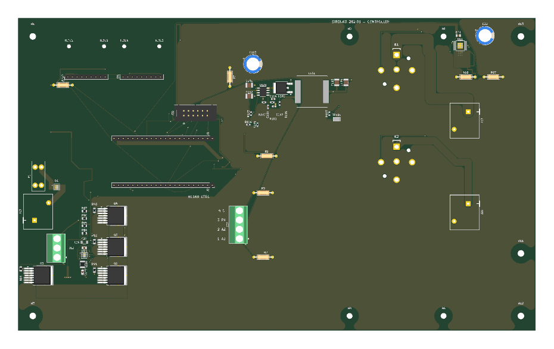
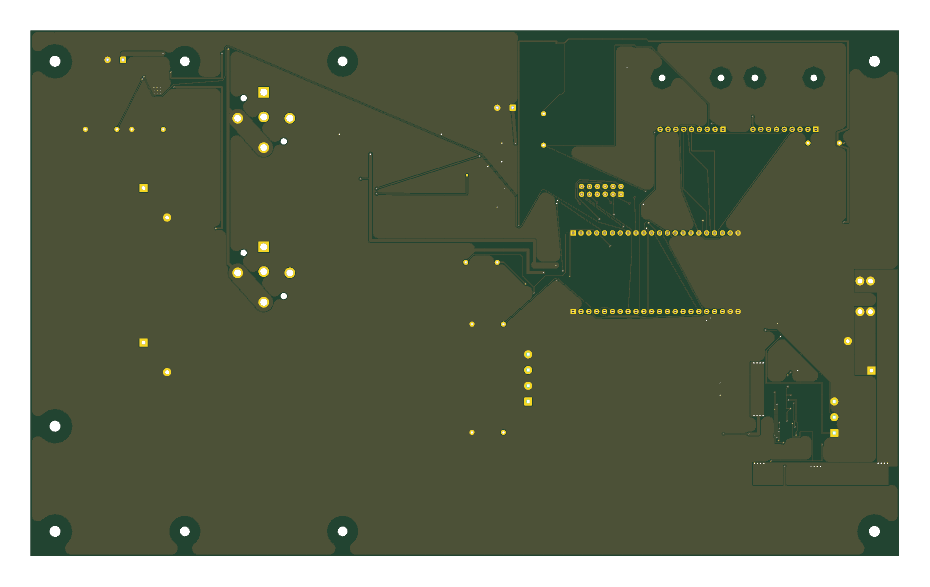

# Исходники платы

Откройте **[Sirokko.kicad_pro](Sirokko.kicad_pro)** в KiCad 10 со стандартными библиотеками. Файлы проекта, функциональные листы схемы и локальные библиотеки образуют один комплект; копируйте каталог целиком.

- `Sirokko.kicad_pcb` — плата.
- `Sirokko.kicad_sch` — корневая схема, остальные `.kicad_sch` — её листы.
- `sym-lib-table`, `fp-lib-table`, `.kicad_sym`, `.pretty/`, `3dmodels/` — зависимости проекта с относительными путями.
- [schematic.pdf](schematic.pdf) — схема для просмотра без KiCad.

Производственные файлы находятся в [manufacturing](../manufacturing/). При изменении схемы или платы обновите соответствующие PDF, Gerber и монтажные ведомости.

[Сборка и подключения](../docs/assembly.md) · [Компоненты](BOM.md) · [Лицензии библиотек](KICAD_LIBRARIES_LICENSE.md)

## Вид платы

Это изображения несущей платы; вставные DevKit, MAX31856 и внешняя панель на них не установлены. Некоторые заказные детали представлены габаритными моделями.
