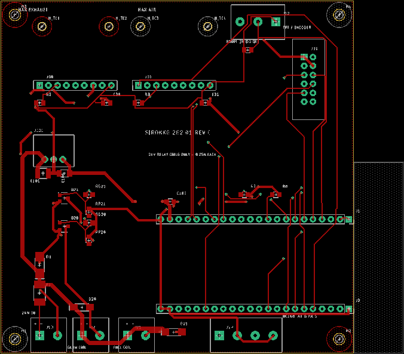
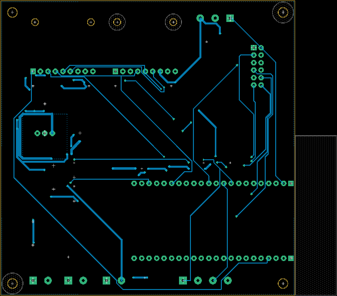

# Плата контроллера

Двухслойная плата 100 × 100 мм для YD-ESP32-S3 N16R8 V1.4, двух модулей MAX31856 и панели TFT с энкодером. Питание — 24 В; преобразователь K7805-1000R3 выдаёт 5 В / 1 А. Ключи AO3422 управляют катушками двух внешних реле.

## Файлы

| Файл | Назначение |
|---|---|
| [Sirokko.sch](Sirokko.sch), [Sirokko.brd](Sirokko.brd) | Связанные схема и плата Fusion Electronics в формате EAGLE |
| [Sirokko-parts.lbr](Sirokko-parts.lbr) | Библиотека компонентов |
| [schematic.pdf](schematic.pdf) | Схема в PDF |
| [BOM.md](BOM.md), [bom.csv](bom.csv) | Ведомость компонентов с артикулами и ценами |

Схема и плата открываются вместе; символы и посадочные места встроены в файлы.

Четыре крепления M3 расположены по углам платы, ещё четыре крепления M2 предназначены для модулей термопар. Антенна ESP32 выступает за правый край; USB-разъёмы доступны слева. Размеры креплений и требования к корпусу приведены в [инструкции сборки](../docs/assembly.md#крепление-и-доступ).

[Изготовление платы](../manufacturing/README.md) · [Подключения](../docs/assembly.md) · [Лицензии библиотек](KICAD_LIBRARIES_LICENSE.md)

## Лицевая сторона

## Обратная сторона

