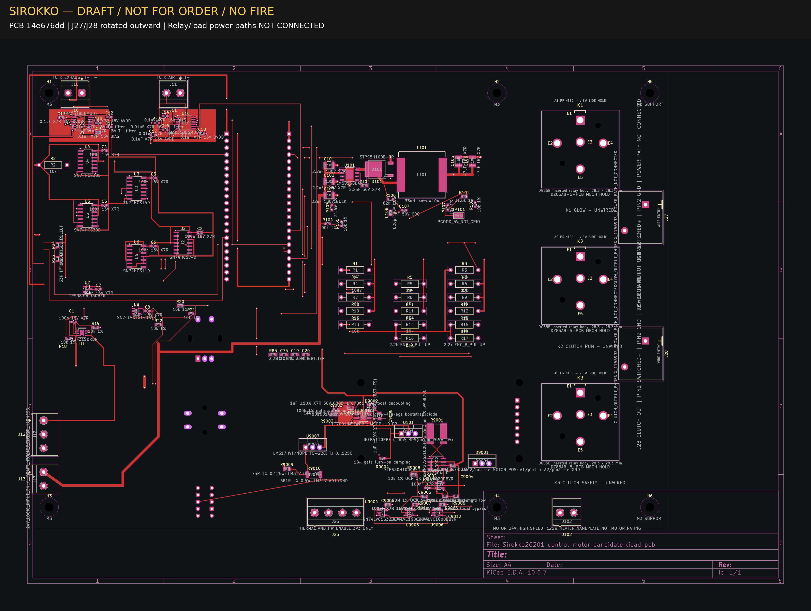

# Sirokko — J27/J28 у правого края, PCB 14e676dd

**WIP / DRAFT / NOT FOR ORDER / NO FIRE. Общая разводка и дальнейшая интеграция прошивки — HOLD.**

Это текущий опубликованный аппаратный снимок. Прежние каталоги `hardware/candidates/` и `hardware/kicad/` сохранены как история, а не параллельные текущие PCB. Снимок не является производственным комплектом или полностью принятой единой компоновкой.

## Граница приёмки

Приняты только механическое размещение постоянных выходов GLOW/CLUTCH J27/J28 и сохранение прежней связности 476 площадок / 5647 связанных пар. Силовые пути реле и нагрузок **НЕ подключены**. Все четыре новые площадки физически изолированы, в том числе обе площадки pin 2 с назначенной сетью GND.

- J27: начало координат (236,37; 60,99) мм, угол −90°.
- J28: начало координат (236,37; 110,99) мм, угол −90°.
- Ввод провода направлен наружу, к правому краю платы.
- Расстояние корпуса до правой Edge.Cuts — 2,50 мм; монтажного габарита courtyard — 2,00 мм.
- K1–K3 сдвинуты на −3,5 мм по X; электрическая квалификация реле не выполнена.

Распиновка колодок реле, допустимое размыкание постоянного тока, высотная сборка TFT/опор и общий монтажный контракт YD остаются открытыми. Изготовление, подключение нагрузок, прошивка устройства и огневые испытания не разрешены.

## Исходники и контрольные суммы

Откройте `Sirokko26201_control_motor_candidate.kicad_pro` в KiCad 10.0.7. В каталоге находятся ровно 25 исходных файлов `AFTER_FULL/`: PCB, корневая схема, проект, парные листы, собственные библиотеки символов и посадочных мест, `fp-lib-table` и `sym-lib-table`. Для внешних стандартных символов, посадок и 3D-моделей нужны штатные библиотеки KiCad; они сюда не скопированы. Отдельные черновые листы не следует считать интегрированными в корневую схему только по наличию файла.

- PCB SHA256: `14e676dd315d7b6450743435452050a5b382a0fde45158df389b1793817c0d0d`.
- Корневая SCH SHA256: `0c30e8aec99435d2e00a2c3f9029a0b80554895aa89a76423a48346fa53948c7`.
- PRO SHA256: `54cf96572352ec0b91e7aaa03886a3f18396c1eaf5db8b1e98d5041825b5b964`.
- [Манифест публикации](PUBLIC_MANIFEST.json) указывает исходный архив, выбранный состав и отсутствие редакторских изменений исходников.
- `sha256sum --check SHA256SUMS` из этого каталога проверяет весь опубликованный состав, кроме самого списка контрольных сумм.

Все 25 исходников, три сохранённых отчёта и изображение перенесены побайтно. Очистка путей не потребовалась; diff исходных файлов относительно выбранных источников пуст. `BEFORE_FULL/`, полный служебный архив, сторонние PDF, PRL, локальные настройки и промежуточные копии не публикуются. Более новые документы и прошивка репозитория не заменены архивными копиями.

## Сохранённые проверки инженера — не новый запуск CAD

- [DRC KiCad 10.0.7](reports/acceptance_drc.json): 13 предупреждений и 80 незавершённых соединений. Это не чистая плата и не производственный PASS.
- [ERC](reports/acceptance_erc.json): 7 предупреждений.
- [Штатное сравнение связности](reports/NATIVE_COMPARISON.json): сохранены назначения сетей и 5647 связанных пар 476 прежних площадок; четыре новые площадки изолированы.

Сравнение явно раскрывает исключение идентификации: у прежней D9002.3 и четырёх новых площадок отсутствуют записанные source UUID. Сопоставление использует UUID посадочного места, номер площадки, геометрию и сеть, а не утверждение о наличии устойчивого UUID у каждой площадки. Ради этой публикации CAD не исправлялся.

Издатель проверил SHA архива, 99 записей `FULL_SHA256SUMS`, 43 записи исторического `BEFORE_FULL/SHA256SUMS`, состав AFTER и побайтовый перенос. CAD, DRC/ERC и тесты прошивки при публикации повторно не запускались; это проверка целостности и публикации уже принятого ограниченного WIP, не стендовая приёмка.

## Изображение текущего снимка

Изображение открыто и просмотрено при публикации. Видимые предупреждения и UNWIRED сохранены; это техническая визуализация незавершённой разводки, не фотография сборки и не доказательство электрической безопасности.
