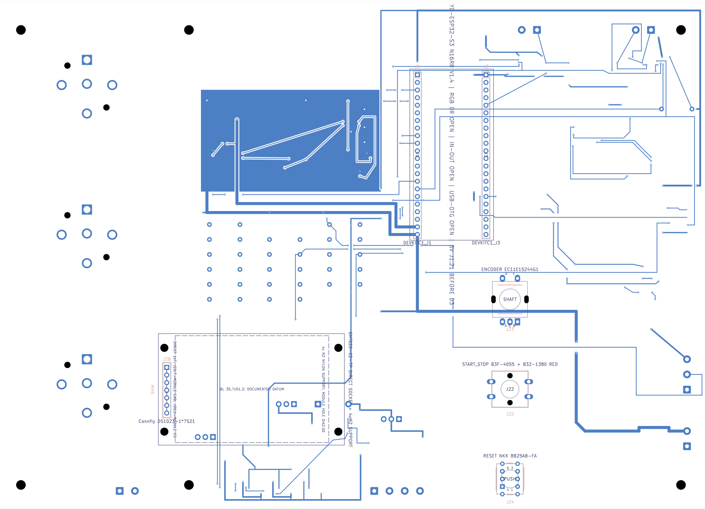

# Panel-v2: принятая 2D-компоновка REQ-029 + YD N16R8

**DRAFT / NOT FOR ORDER / NO FIRE.** Это неизменяемый WIP-снимок принятой компоновки, не электрически завершённая плата, не производственный комплект и не разрешение подключать нагрузки или топливо.

## Источник и границы

Перенесены побайтно все 18 файлов из `SIROKKO_PANEL_V2_REQ029_YD_DRAFT_d015fbb1.tar.gz`:

- SHA256 исходного архива: `b0174da5147034f1a3783b817e608fa0c2f4d4c414c3a1f71e42b2d41da2265c`.
- SHA256 [PCB](Sirokko26201_control_motor_candidate.kicad_pcb): `d015fbb1e4eea7caec96bf9dd34dcf0220e50bde06f0fbe3e7eed67ecfeaf3a3`.
- [Исходный манифест](SHA256SUMS.txt) проверяет 17 файлов; сам манифест и этот добавленный README в него не входят.
- Сторонние PDF и модели не включены; ссылки на документацию сохранены в исходных отчётах. Служебные пути в отчётах обозначают исходную инженерную среду, а не пути внутри репозитория.

Итоговое решение — [ENGINEERING_ACCEPTANCE_RU.txt](ENGINEERING_ACCEPTANCE_RU.txt) и [ACCEPTANCE.json](ACCEPTANCE.json). Они имеют приоритет над более ранними формулировками «компоновка не принята» внутри неизменённых исследовательских документов этого снимка. Прежняя база без REQ-029 не является источником этой публикации.

Принята только единая 2D-компоновка: TFT слева; справа энкодер, одна ПУСК/СТОП и RESET на общей оси. Подтверждены номинальные 60 мм от края окна до оси и шаги 30/30 мм; плата 235×170 мм. Это не проверка допусков, высот или физического хвата. Разрешено продолжать разводку на отдельной рабочей копии с повторной проверкой связности, заливок и полного DRC. Этот каталог не редактировать; следующую контрольную точку сохранять отдельно.

YD-ESP32-S3 N16R8 V1.4 отражён документарным контуром и [картой контактов](DEVKIT_YD_V14_TO_CARRIER_PINMAP.csv). Сборочные условия: снять RGB 0R; IN-OUT и USB-OTG оставить разомкнутыми. GPIO48 остаётся TFT_DC, GPIO19/20 — USB, GPIO35/36/37 не используются из-за Octal PSRAM. Точные D1…D3 и питание ещё не квалифицированы. Прошивка под 16 MB Flash / 8 MB Octal PSRAM актуализируется отдельно; эта публикация её не меняет и не разрешает прошивку устройства.

## Проверки и открытые ограничения

- Инженерные чтение PCB, проверка размещения и DRC KiCad 10.0.7 сохранены в отчёте приёмки; издатель CAD/DRC повторно не запускал и исходники не менял.
- Сохранённый [полный DRC JSON](Sirokko26201_control_motor_candidate-drc.json) и [текстовый отчёт](FINAL_DRC.rpt): **84 незавершённых соединения severity=error, 10 предупреждений** (2 `lib_footprint_mismatch`, 8 `track_dangling`), 5 прежних исключённых проверок. Это не общий PASS.
- K1/K2/K3 остаются UNWIRED. RESET F-side NO/NC, высоты ручки/кнопок/TFT/колодок, питание YD и механика обслуживания не закрыты.
- Физические, тепловые, ЭМС, производственные и огневые испытания не выполнены. Gerber/BOM/CPL из этого пакета не выпускать; это не полный автономный схемный проект.
- При публикации выполнены `sha256sum -c SHA256SUMS.txt` и `python3 VERIFY.py`: 17/17 OK и PASS. VERIFY проверяет целостность последней правки B.Fab, сохранённые отчёты и SVG, а не электрическую или производственную готовность.

Повторить проверку из этого каталога без дополнительных пакетов:

```sh
sha256sum -c SHA256SUMS.txt
python3 VERIFY.py
```

## Изображение B-side

**DRAFT / NOT FOR ORDER / NO FIRE.** [PNG](B_SIDE_DRAFT.png) и [SVG](B_SIDE_DRAFT.svg) сохранены без наложения новой маркировки. Предупреждение относится ко всему изображению; оно не является шаблоном изготовления. Плотные и перекрывающиеся служебные подписи остаются WIP-оформлением.


