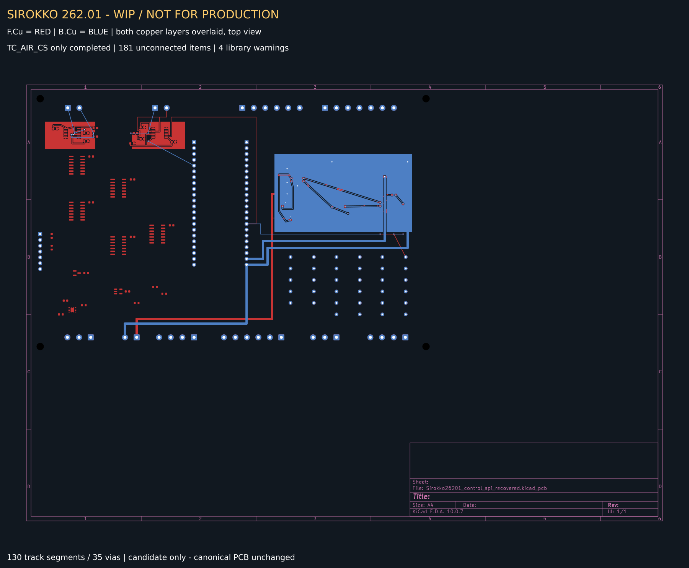

# SPI recovered — отдельный WIP-кандидат PCB

> WIP / DRAFT / НЕ ДЛЯ ПРОИЗВОДСТВА. Этот каталог не заменяет основную PCB в `hardware/kicad/`. Завершена только цепь `/TC_AIR_CS`, не вся SPI-разводка.



Красный — `F.Cu`, синий — `B.Cu`. Обе медные стороны наложены, вид сверху; это не зеркальный вид снизу и не производственный чертёж. PNG получен из [исходного экспорта KiCad](Sirokko26201_control_spi_recovered.svg) с добавленной пометкой WIP и легендой, без изменения геометрии.

## Что сохранено

- `Sirokko26201_control_spi_recovered.kicad_pcb` — побайтная копия проверенного кандидата: 88 посадочных мест, 130 сегментов, 35 переходных отверстий, 90 записей цепей KiCad (включая несоединённую), 3 зоны, толщина 1,6 мм.
- По сравнению с основной восстановленной PCB: +7 сегментов и +3 переходных отверстия. К существующему соединению J1.15 → U10.9 добавлено R3.2 → J1.15; цепь `/TC_AIR_CS` больше не присутствует среди непроложенных соединений DRC.
- `fp-lib-table` и три каталога `Sirokko_*.pretty` — используемые проектные посадочные места, с относительными ссылками `${KIPRJMOD}`. Помимо них нужны штатные библиотеки KiCad. Открывайте файл PCB в KiCad 10.0.7; отдельные схема и файл проекта для этого кандидата не созданы.
- `Sirokko26201_control_spi_recovered-drc.json` — сохранённый независимый отчёт KiCad 10.0.7 по этому кандидату от 2026-10-25 11:46:35. Это существующая проверка автора, не повторно запущенный при публикации DRC. Отчёт скопирован без изменения.
- `manifest.json` фиксирует контрольные суммы исходных файлов и границы проверки; `SHA256SUMS` позволяет проверить весь опубликованный комплект.

## Проверки и ограничения

Отчёт содержит 181 непроложенное соединение (в исходной основной PCB — 182) и прежние 4 предупреждения `lib_footprint_mismatch`: J23, C1, J24, J25. Других записей в `violations` нет. Это не «DRC без ошибок»: непроложенные соединения остаются ошибками в `unconnected_items`.

Пять отключённых проверок перечислены в `ignored_checks` отчёта; при публикации подавления не добавлялись. Сверка кандидата со схемой и новый ERC не выполнялись. Пустой `schematic_parity` не означает подтверждённую согласованность схемы с платой.

SPI и силовые цепи не завершены. Два близких переходных отверстия (170; 75) и (174; 75) связаны медью на обеих сторонах: рабочая топология оставлена как есть из-за отсутствия адресного удаления в использованном интерфейсе. Это не оптимизированное окончательное решение.

Основная PCB, схема, прошивка, настройки служб и исходные файлы автора не изменены. Gerber, Drill, производственный BOM и разрешение на заказ или подключение горелки не выпускались.

## Проверка копии

```sh
cd hardware/candidates/spi_recovered
sha256sum -c SHA256SUMS
```
