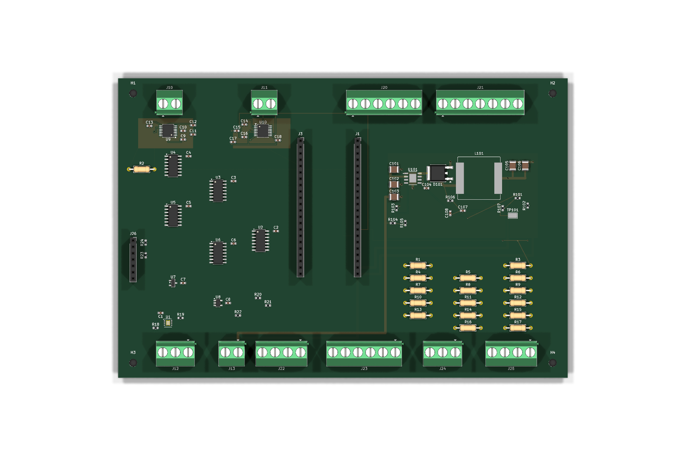
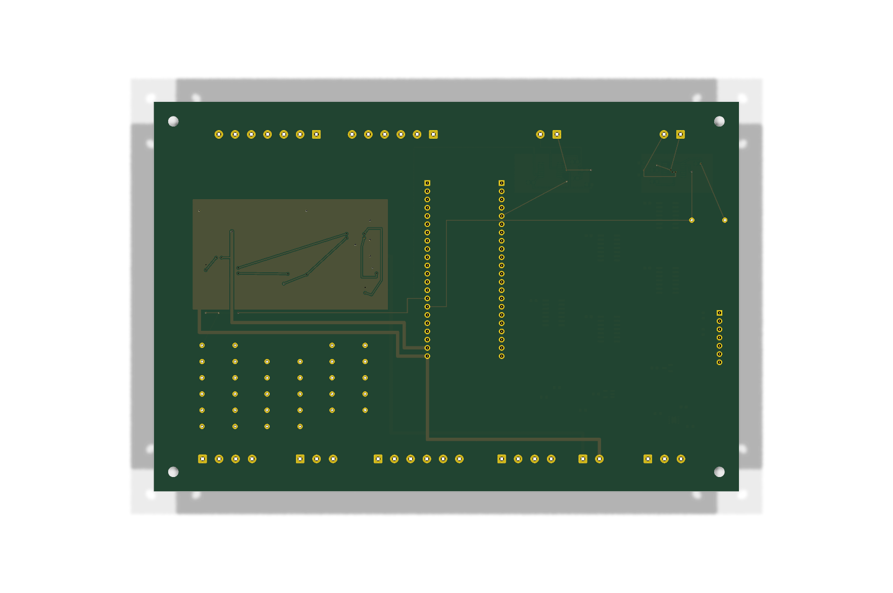

# SPI 138/37 — закрыта только цепь TC_EXH_CS

> WIP / DRAFT / НЕ ДЛЯ ПРОИЗВОДСТВА. Полностью подключена `/TC_EXH_CS`, но не вся SPI-разводка и не вся плата. Основная PCB в `../../kicad/`, [снимок 130/35](../spi_recovered/) и предыдущий [частичный снимок 137/36](../spi_tc_exh_cs_partial_137_36/) не заменены.

## Состояние

- 88 посадочных мест, 138 сегментов дорожек, 37 переходных отверстий, 90 записей цепей KiCad, 3 зоны. Количества проверены по сохранённому PCB-файлу.
- По отчёту автора цепь `/TC_EXH_CS` теперь включает U9.9, J1.16 и R2.2. R2 перенесён без поворота: начало координат `(14.34, 46.43)`, pad 2 `(24.50, 46.43)` лежит на существующей медной дорожке.
- R2.1 `/+3V3` подключён дорожкой B.Cu к C13.1 через переходное отверстие `(21.725, 29.05)`.
- Среди `unconnected_items` сохранённого DRC нет `/TC_EXH_CS`.
- Ещё НЕ закрыты `/TC_SCK`, `/TC_SDI_MOSI`, `/TC_SDO_MISO`, `/TC_EXH_DRDY`, `/TC_AIR_DRDY`. Силовая часть и готовность всей платы здесь не подтверждаются.

## Сохранённая проверка

[Полный DRC JSON](drc/Sirokko26201_control_spi_verified-drc.json): KiCad 10.0.7, отметка времени `2026-10-25T12:40:23`, после заполнения зон по отчёту автора.

- `violations`: 4 прежних предупреждения `lib_footprint_mismatch` у J23, C1, J24, J25; массив полностью совпадает с предыдущим отчётом 137/36.
- `unconnected_items`: 178 ошибок непроложенных соединений. Это НЕ «DRC без ошибок» и не основание заказывать плату.
- Пять записей `ignored_checks` совпадают с предыдущим отчётом; подавления не добавлялись.
- При публикации новый DRC, ERC и сверка со схемой не запускались. Пустой `schematic_parity` не подтверждает согласованность схемы и PCB.

## Файлы и изображения

- [PCB](Sirokko26201_control_spi_verified_TC_EXH_CS_complete_WIP.kicad_pcb) и [REPORT_RU.md](REPORT_RU.md) сохранены без изменений.
- Медь: [F.Cu SVG](images/front/Sirokko26201_control_spi_verified.svg), [B.Cu SVG](images/back/Sirokko26201_control_spi_verified.svg). Дополнительный исходный экспорт `images/Sirokko26201_control_spi_verified.svg` также сохранён.
- [3D сверху](images/Sirokko26201_control_spi_verified-3d-top.png), [3D снизу](images/Sirokko26201_control_spi_verified-3d-bottom.png). Это виды незавершённой платы, не производственные чертежи.





## Происхождение и целостность

Источник — только неизменяемый `Sirokko_SPI_TC_EXH_CS_complete_WIP.tar.gz`, SHA-256 `1ecfc56c91838a13883fc526f8e2b82cfe455fc288f3e23db5c0a511453988b3`, каталог архива `accepted_spi_complete_next/`. Текущая изменяемая рабочая копия не использовалась.

SHA-256 PCB: `090baef6e1c599ead63427344a430f65fcdf9f9d18d29bb206b0bc6d5ab87e09`.

Восемь исходных файлов платы, отчётов и изображений скопированы побайтно, без пересохранения. Исходный `SHA256SUMS.txt` проверен, но не опубликован из-за внутреннего абсолютного пути; вместо него добавлен `SHA256SUMS` с относительными путями для всех опубликованных файлов:

```sh
cd hardware/candidates/spi_tc_exh_cs_complete_138_37
sha256sum -c SHA256SUMS
```

Основные схема/PCB, прежние снимки и прошивка при этой публикации не менялись. Gerber, Drill, производственная BOM и стендовые испытания здесь не выпускались и не подтверждались. Этот снимок не разрешает заказ платы или эксплуатацию горелки.
