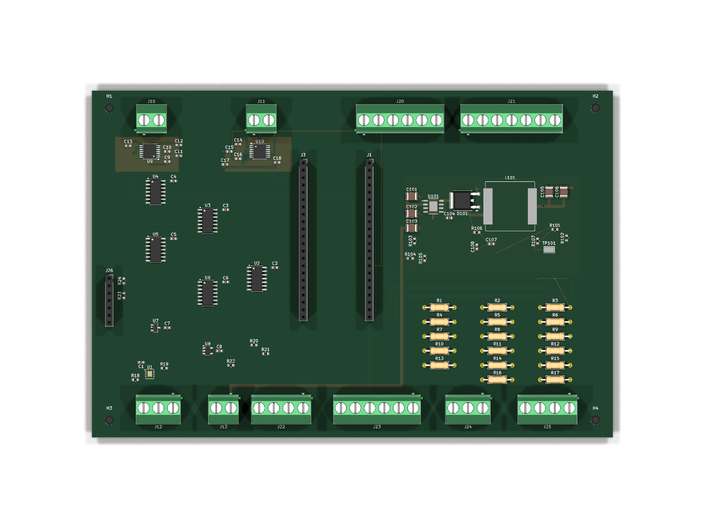
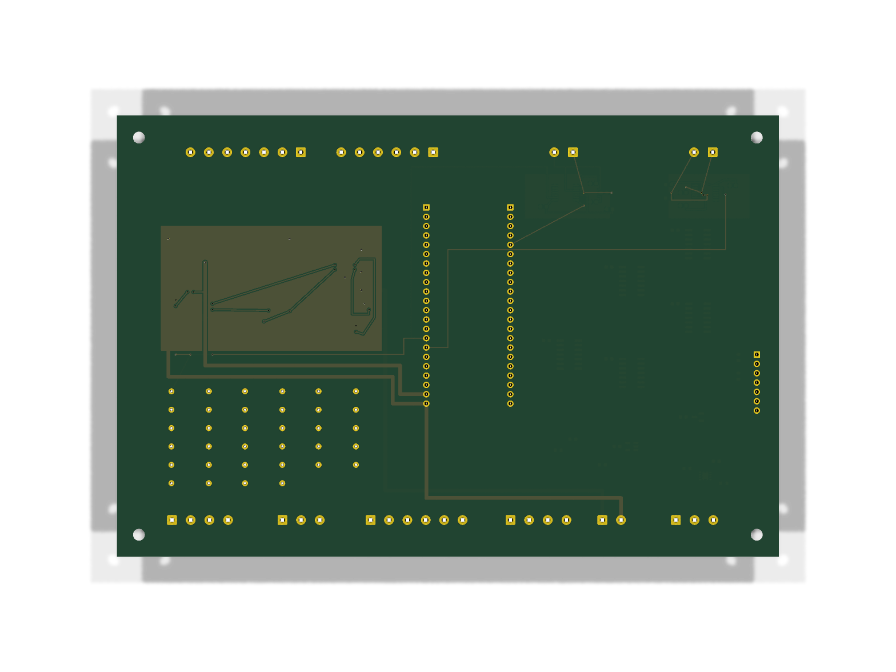

# SPI 137/36 — частичная разводка TC_EXH_CS

> WIP / DRAFT / НЕ ДЛЯ ПРОИЗВОДСТВА. Это неизменяемый инженерный снимок, а не завершённая SPI-разводка или комплект для заказа платы. Основная PCB в `../../kicad/` и предыдущий [снимок 130/35](../spi_recovered/) не заменены.

## Состояние

- 88 посадочных мест, 137 сегментов дорожек, 36 переходных отверстий, 90 записей цепей KiCad, 3 зоны. Количества проверены по сохранённому PCB-файлу.
- По отчёту автора добавлено непрерывное медное соединение `/TC_EXH_CS`: U9.9 → J1.16, ширина 0,25 мм, переходное отверстие 0,60/0,30 мм в точке (24,50; 31,50).
- R2.2, подтягивающий резистор этой же цепи, ещё НЕ подключён. Его непроложенное соединение присутствует в DRC: `/TC_EXH_CS` целиком не завершена.
- `/TC_SCK`, `/TC_SDI_MOSI`, `/TC_SDO_MISO`, `/TC_EXH_DRDY` на этом этапе не менялись. Остальная SPI-разводка и силовые цепи не объявляются завершёнными.

## Сохранённая проверка

[Полный DRC JSON](drc_final_partial_spi/Sirokko26201_control_spi_verified-drc.json) получен автором после заполнения зон в KiCad 10.0.7; отметка времени в отчёте — `2026-10-25T12:28:59`.

- `violations`: 4 прежних предупреждения `lib_footprint_mismatch` у J23, C1, J24, J25; других записей в этом массиве нет.
- `unconnected_items`: 180 ошибок непроложенных соединений, включая R2.2. Поэтому это НЕ «DRC без ошибок».
- `ignored_checks`: 5. Настройки и подавления при публикации не менялись.
- Новый DRC, ERC и сверка со схемой при публикации не запускались. Пустой `schematic_parity` не подтверждает согласованность схемы и PCB.

## Файлы и изображения

- [PCB](Sirokko26201_control_spi_verified_TC_EXH_CS_partial_verified.kicad_pcb) — исходные байты, без открытия с пересохранением и без нормализации окончаний строк.
- [REPORT_RU.md](REPORT_RU.md) — исходный отчёт автора без изменений.
- Медь: [F.Cu SVG](svg_f_cu/Sirokko26201_control_spi_verified.svg), [B.Cu SVG](svg_b_cu/Sirokko26201_control_spi_verified.svg).
- Сохранённые 3D-виды: [сверху](png_top/Sirokko26201_control_spi_verified-3d-top.png), [снизу](png_bottom/Sirokko26201_control_spi_verified-3d-bottom.png). Это изображения незавершённой платы, не производственные чертежи.





## Происхождение и целостность

Использован только зафиксированный архив `Sirokko_TC_EXH_CS_partial_verified_bundle.tar.gz`, SHA-256 `252f8045de766d4c9729366e6b8d109d0878537ef2a76c8aa6156197b86a833e`. Вложенный `Sirokko_TC_EXH_CS_partial_verified.tar.gz`: SHA-256 `863b34333a36261fcb21183889ca74f6675f27c59220e2a6b554f838b10d71b2`. Все 7 исходных файлов из его `accepted_spi_next/` опубликованы побайтно; дубли отчёта и PNG во внешнем архиве совпали.

SHA-256 PCB: `a946ff99a0c130f76bef8e72acddee72f674146e059f2b252f3a1984aca54005`.

```sh
cd hardware/candidates/spi_tc_exh_cs_partial_137_36
sha256sum -c SHA256SUMS
```

Текущая изменяемая рабочая копия не использовалась. Основные схема/PCB, предыдущие снимки и прошивка не менялись. Gerber, Drill, производственная BOM, монтаж и стендовые испытания здесь не выпускались и не подтверждались; заказ платы и эксплуатация горелки этим снимком не разрешаются.
