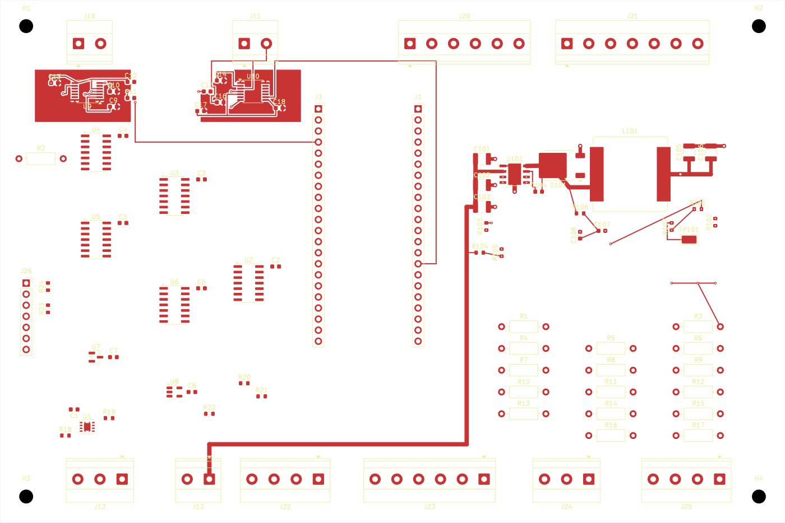
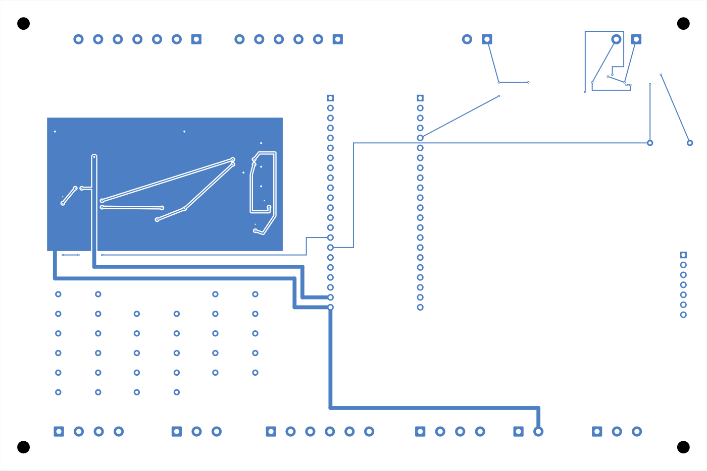

# SPI DRDY/GND 148/39 — проверенный промежуточный снимок

> WIP / DRAFT / NOT FOR ORDER. Не для производства и не допуск к эксплуатации горелки. Отдельный неизменяемый снимок; основной проект, прежние кандидаты и прошивка не заменены.

## Что сохранено

- 148 сегментов дорожек, 39 переходных отверстий, 88 посадочных мест, 3 зоны; количества проверены по исходному PCB.
- По [отчёту автора](REPORT_RU.md), штатный движок связности KiCad подтвердил общую группу GND `U9.1 / U9.14 / C9.2 / C10.2 / C13.2` и отдельно `/TC_EXH_DRDY` между `U9.7` и `J3.4`. Обход DRDY устранил две GND-регрессии предыдущего кандидата 145/37.
- [Сохранённый DRC](parent_drc_final.json): KiCad 10.0.7, `2026-10-25T15:11:12`; 177 непроложенных соединений, 4 предупреждения `lib_footprint_mismatch` у J23/C1/J24/J25 и 5 отключённых проверок. Это НЕ «DRC без ошибок».
- SCK/MOSI/MISO в этом снимке не завершены. Уже опубликованный [отдельный кандидат TC_SCK 152/41](../spi_tc_sck_full_152_41/) сохранён без изменений; эта публикация не объединяет кандидаты и не отменяет его результат.
- Схемная эквивалентность, интеграция моторного узла и физические испытания не подтверждены. При публикации KiCad, заливка зон, DRC и проверка связности заново не запускались; сохранены принятые исходные байты и результаты автора.

## Файлы

[PCB](Sirokko26201_control_spi_verified_DRDY_complete_WIP.kicad_pcb), одноимённый `.kicad_pro`, `fp-lib-table`, две проектные библиотеки посадочных мест, отчёт, полный DRC, SVG/PNG обеих сторон и исходный `SHA256SUMS` скопированы без изменений. Схема `.kicad_sch` в исходный архив не входила. Пустой исходный каталог `Sirokko_Input.pretty/` сохранён с помощью `.gitkeep`; посадочных мест из этой библиотеки в PCB нет.





Это обзорные изображения разводки, не 3D-модель и не доказательство электрической связности.

## Происхождение и проверка

Источник: `Sirokko_SPI_DRDY_GND_verified_WIP.tar.gz`, каталог `SPI_DRDY_GND_WIP/`.

- SHA-256 архива: `3518320a1d9876dc8f23748f6b1d7c2e0b7bd1980da6fb4105a675518587bc7f`.
- SHA-256 PCB: `e9d65206d3649cc8a4a4d008d0e0879137f25ff7e4f4abc6ebf92dce01a0eae1`.
- Все 12 исходных файлов, включая `SHA256SUMS`, сохранены побайтно; 11/11 записей исходного списка проверены. Добавлены только этот README и пустой `.gitkeep`.

Из корня репозитория:

```sh
(cd hardware/candidates/spi_tc_exh_drdy_gnd_verified_148_39 && sha256sum -c SHA256SUMS)
```

Gerber, Drill, производственная BOM и разрешение на заказ платы этой публикацией не выпускаются.
