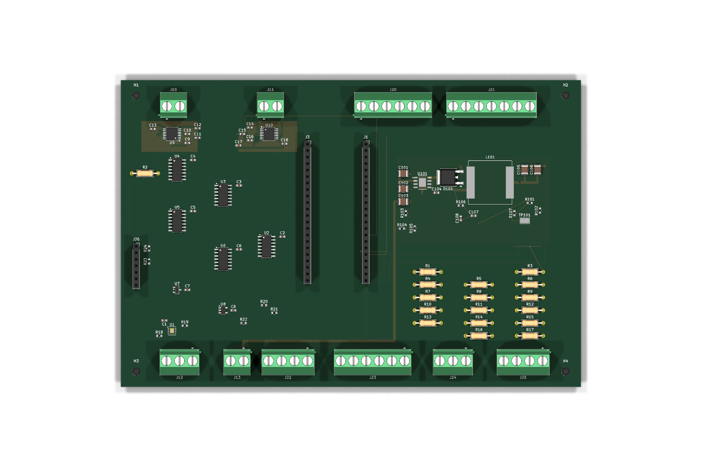
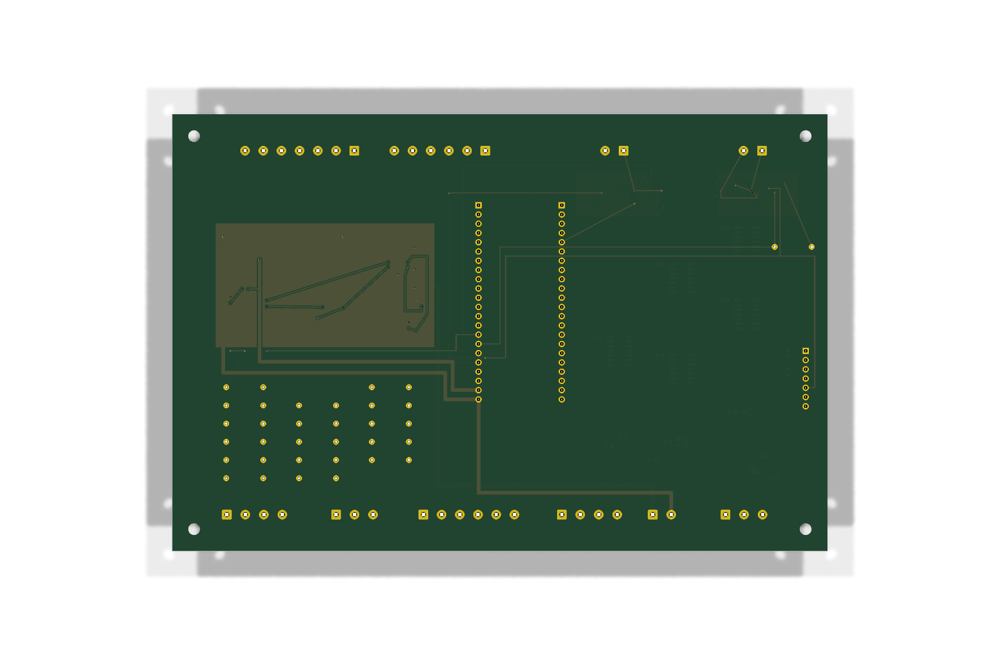

# SPI 152/41 — замкнута вся цепь TC_SCK

> WIP / DRAFT / НЕ ДЛЯ ПРОИЗВОДСТВА. Отдельный неизменяемый снимок незавершённой платы, не комплект для заказа и не допуск к эксплуатации горелки.

`/TC_SCK` соединяет **U9 pad 10, U10 pad 10, J1 pad 18 и J26 pad 5**. Среди `unconnected_items` сохранённого DRC этой цепи нет. Здесь опубликован только полный вариант 152/41, не промежуточный 149/41 с неподключённым J26 pad 5.

- 88 посадочных мест, 152 сегмента дорожек, 41 переходное отверстие, 90 записей цепей KiCad, 3 зоны; толщина 1,6 мм.
- Продолжение [TC_EXH_CS 138/37](../spi_tc_exh_cs_complete_138_37/), а не замена [основного проекта](../../kicad/) или прежних кандидатов.
- Сохранённый DRC: **175 ошибок непроложенных соединений**, 6 библиотечных предупреждений и 5 отключённых проверок. Это НЕ «DRC без ошибок»; вся SPI-разводка и силовые цепи не завершены.
- Основной проект KiCad и прошивка не менялись. Последующие решения основной схемы автоматически в снимок не переносятся.

## Файлы

- [PCB](Sirokko26201_control_spi_sck_full.kicad_pcb) — исходные байты без пересохранения.
- [Отчёт](../../../verification/candidates/spi_tc_sck_full_152_41/REPORT_RU.md), [полный DRC](../../../verification/candidates/spi_tc_sck_full_152_41/Sirokko26201_control_spi_sck_full-drc.json) и [DRC исходной контрольной точки](../../../verification/candidates/spi_tc_sck_full_152_41/baseline_TC_EXH_CS_complete-drc.json).
- [Вид сверху](../../../renders/candidates/spi_tc_sck_full_152_41/Sirokko26201_control_spi_sck_full-3d-top.png) и [вид снизу](../../../renders/candidates/spi_tc_sck_full_152_41/Sirokko26201_control_spi_sck_full-3d-bottom.png) — именно этого PCB, не промежуточного 149/41.





Проверка из корня репозитория:

```sh
sha256sum -c hardware/candidates/spi_tc_sck_full_152_41/SHA256SUMS
```

SHA-256 платы: `67e74ccd59738edb4a6afbec7bfa5272b68bf05a5f7145f7a0909f63c5933a6f`.

Gerber, Drill, производственная BOM, сборочные чертежи и результаты физических испытаний в этой публикации не выпускались. Заказывать плату или подключать топливо по этому снимку нельзя.
