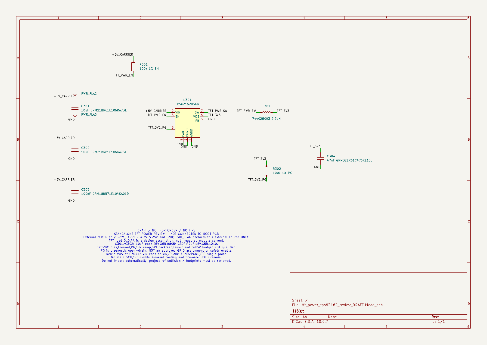

# TPS62162: отдельный проверочный лист TFT 5 → 3,3 В

**DRAFT / NOT FOR ORDER / NO FIRE. `standalone_not_integrated`; `production_release=false`. Общая разводка и прошивка — HOLD.**

Это самостоятельный лист, не подключённый к root SCH и основной PCB. Он не заменяет [текущий аппаратный WIP J27/J28, PCB 14e676dd](../j27_j28_14e676dd/README_RU.md). Основная SCH, PCB, производственная BOM, прошивка и прежние кандидаты не изменены. Заказ, изготовление, подключение нагрузок и огневые испытания не разрешены.

## Состав и происхождение

- [Родная SCH](tft_power_tps62162_review_DRAFT.kicad_sch) исправлена относительно commit `aad1652650c8786924ec5433ee808d7a3922fecf`: только положения/ориентации Reference/Value, видимость служебных #FLG Reference и ориентация/выравнивание меток в прежних якорях. U301 — две строки над корпусом; L301 — сверху/снизу горизонтально; C/R — справа в две строки. Единственная смысловая правка — скрытые MPN/Manufacturer/Supplier/Datasheet/Supplier_URL обоим R301/R302. Значения сохранены. Исходная SCH SHA256 `53c1ce4366eda6a2a700bf841c1add75976813fd38cfbb425db891a6d7d8b1e1`.
- [Публичный XML](tft_power_tps62162_review_DRAFT.xml) заново экспортирован из исправленной SCH: удалён только рабочий префикс `design/source`, остальные байты native-экспорта сохранены. Исходный XML до исправления SHA256 `ee03bfe4de3d39b04444de46411408cbcf1929d3d7eba1362073f104a17b49a6`; вся карта pin→net совпала.
- [Новый PDF](tft_power_tps62162_review_DRAFT.pdf) и [его PNG](tft_power_tps62162_review_DRAFT.png) согласованы с исправленной SCH. PNG: `pdftoppm -png -r 180 -singlefile`, **2105×1489 px**. Исторический PDF SHA256 `772ac18c4de713471dff66c6a09130e75e4133d2d9bf88a2e41f3e51aff80e59` с наложениями остаётся в истории Git, не является текущим экспортом.
- [Полный повторный ERC](tft_power_tps62162_review_DRAFT-erc.json), [журнал штатных команд](NATIVE_COMMANDS.json), [полная карта XML](NET_MAP.json), [обратная проверка флагов](PWR_FLAG_READBACK.json), [проверка допустимости правки](FIELD_EDIT_VERIFICATION.json), [сравнение до/после](NATIVE_VERIFICATION.json), [манифест](PUBLIC_MANIFEST.json), [SHA256SUMS](SHA256SUMS).
- [Авторский расчёт](../../../docs/research/TFT_3V3_TPS62162_SELECTED_DESIGN_CALC_RU.md): исходные MPN, числа, ограничения и отзыв неподтверждённых MPN сохранены; история первой публикации отделена от новой правки. Исходный авторский SHA256 `55453c4f7169e16f18ed93a4b446a2b506c9c693cd52421e9ab65a2ea5cc750f`.

Правка выполнена операциями над данными документа установленного `mcp-server-kicad 0.21.1` (`_cst`/`_atomic_write`), без собственного парсера/генератора, изменений MCP или установок. Обратная замена только разрешённых полей/ориентаций восстановила **все исходные байты**. Положения/повороты символов, провода, якоря меток, UUID, библиотеки и прочие свойства не менялись.

Сторонние паспорта не включены: ссылки на TI, Murata, Würth и закупочные карточки оставлены в расчёте. Цены/остатки там — зафиксированные автором наблюдения, не обещание текущих поставок.

## Компоненты и ограничения символа

В XML восемь электрических компонентов; в SCH дополнительно два PWR_FLAG. Лист A4, 23 провода и 23 локальные метки; дочерних листов нет.

| Ref | Выбранное значение/MPN |
|---|---|
| U301 | TPS62162DSGR, fixed 3,3 В / 1 А |
| L301 | Würth 744025003, 3,3 µH |
| C301, C302 | каждый 10 µF, GRM21BR61E106KA73L, 25 В, X5R, 0805 |
| C303 | 100 nF, GRM188R71E104KA01D |
| C304 | 47 µF, GRM32ER61C476KE15L, 16 В, X5R, 1210 |
| R301, R302 | каждый 100 kΩ, 1%; Yageo RC0603FR-07100KL, ChipDip9000632023 |

U301 использует **геометрию библиотечного TPS62170DSG**, но Value/Description/Datasheet экземпляра задают **TPS62162DSGR**. Это не замена выбранной ИС на TPS62170. Девять номеров/имён выводов сохранены; карта ниже проверена целиком. Встроенный библиотечный текст всё ещё описывает TPS62170 как 500 mA adjustable; это унаследованные метаданные геометрии, не спецификация выбранного TPS62162. Не использовать `libsource` как производственный MPN.

У всех восьми экземпляров поле Footprint пустое, в том числе у U301. Посадка, EP, трафарет и тепловые переходы не назначены/не квалифицированы. Типовая посадка внутри библиотечного описания не является назначенной посадкой экземпляра. Этот лист не пригоден для автоматического импорта в основную PCB: требуется проверка коллизий Ref, всех посадок и системных соединений.

## Полная карта соединений XML

Начальный `/` — штатный префикс имени сети в XML; он сохранён, не удалён при сравнении. Проверены ровно шесть сетей и все 23 электрических вывода, без лишних или пропущенных узлов.

| Сеть XML | Все узлы |
|---|---|
| `/+5V_CARRIER` | C301.1, C302.1, C303.1, R301.1, U301.2 (VIN) |
| `/GND` | C301.2, C302.2, C303.2, C304.2, U301.1 (PGND), U301.4 (AGND), U301.5 (FB), U301.9 (EP/PAD) |
| `/TFT_PWR_EN` | R301.2, U301.3 (EN) |
| `/TFT_PWR_SW` | L301.1, U301.7 (SW) |
| `/TFT_3V3` | C304.1, L301.2, R302.1, U301.6 (VOS) |
| `/TFT_3V3_PG` | R302.2, U301.8 (PG) |

PWR_FLAG не входят в список электрических компонентов/узлов XML. Отдельный обратный запрос MCP подтвердил #FLG301.1 на +5V_CARRIER в (45,72;59,69) мм и #FLG302.1 на GND в (45,72;72,39) мм. Других PWR_FLAG нет. Они объявляют только внешний источник изолированного проверочного листа: не подтверждают LM5013, общий бюджет 5 В или интеграцию в root. PG — диагностический open-drain, не питание, не назначенный GPIO и не разрешение безопасности.

## Повторные штатные проверки

Исходная и исправленная SCH заново прочитаны KiCad 10.0.7 при экспорте XML/ERC, исправленная — также при экспорте PDF. Приложение GUI не использовалось; это проверка штатным CLI, а не заявление о просмотре редактора. Первичная MCP-проверка флагов сохранена; строгая побайтовая проверка разрешённой правки подтверждает неизменность их присоединений.

- `kicad-cli sch erc --format json --exit-code-violations`: **exit 0, 0 нарушений**, только этот standalone-лист, не root. Полный отчёт содержит четыре отключённых проверки: `single_global_label`, `four_way_junction`, `simulation_model_issue`, `footprint_filter`. Настройки не менялись; результат не называется строгим ERC со всеми включёнными правилами.
- Повторный `kicad-cli sch export netlist --format kicadxml`: exit 0, та же полная карта шести сетей и значения восьми компонентов.
- Повторный `kicad-cli sch export pdf`: exit 0. Это новый PDF исправленной SCH, не прежний файл с наложениями. Его PNG побайтно совпал с окончательным осмотренным растром.
- Исходный и повторный PDF открыты установленным Poppler (`pdfinfo`, `pdftoppm`): одна страница A4 landscape, без шифрования, штатный KiCad PDF с интерактивными свойствами/JavaScript. Дата `/CreationDate` записана KiCad нестандартно, поэтому результат её разбора `pdfinfo` не используется как достоверное время создания.
- `python3 VERIFY.py`: контроль SHA256, точного состава, всей XML-карты, значений, девяти выводов U301, пустых Footprint и ERC. Повторный native-экспорт не требуется для запуска этой проверки; журнал его реального выполнения сохранён отдельно.

Новые пакеты/службы не устанавливались, Hermes и соседние проекты не менялись. Полный DRC основной PCB, системный ERC, расчёт новой модели и физические испытания не выполнялись.

## Визуальная проверка: исправление ожидает независимой приёмки

Дефекты исходника воспроизведены по прежнему PNG: Value U301 перекрывал PAD/PGND/AGND; Ref/Value L301 были вертикальными и накладывались; поля C/R пересекали проводники; метки питания/земли и PWR_FLAG были скучены.

[Конечный PNG нового PDF](tft_power_tps62162_review_DRAFT.png) открыт и осмотрен целиком, три GND под U301 дополнительно крупно. После второго разнесения выравниванием наложений Ref/Value/меток на посторонний текст или провода не обнаружено. Рамка/штамп целые. Вертикальные имена PAD/PGND/AGND внутри библиотечного символа не менялись; скрытый Description U301 не отображается. **Оформление независимо принято инженером:** он самостоятельно получил PDF с SHA256 `00c994b9d595ee2c361ac645fe1745a54d8e4414679a6e22c0e0cd01e424a8eb`, осмотрел растр шириной 3500 px и подтвердил читаемость U301/L301/C/R/трёх GND без наложений/обрезки. Инженер также самостоятельно сравнил native XML до/после с независимым контрактом: 6 сетей/23 вывода EXACT, EP9→/GND, Footprint пусты у всех 8. [Фиксация приёмки](ENGINEER_ACCEPTANCE.json). Это графическая приёмка отдельного DRAFT, не производственный допуск. ERC не заменяет осмотр.

## Что не квалифицировано

Точный гарантированный Ceff с DC bias/допуском/температурой; тепловой и токовый режим; общий бюджет 5 В; полный ток TFT; EN/PG, запуск/броски/PSM/PWM/обратное питание через SPI; разводка и посадки. **20 µF на выходе и 8 µF на входе — условные параметры проверочных моделей, не гарантированные ёмкости.** Номинальные 20 µF двух входных конденсаторов — другая величина, не доказанный Ceff. Сохраняются ограничения и отзыв прежних неподтверждённых MPN в авторском расчёте. Ноль ERC не доказывает электрическую работоспособность, совместимость полного диапазона с модулем или производственный допуск.

PG также Hi-Z при EN OFF / UVLO / TSD по TI §8.3.3; он не универсальное разрешение безопасности.

## DC-проверка выбранных R301/R302

Скрытые свойства обоих резисторов: MPN `RC0603FR-07100KL`, Manufacturer `Yageo`, Supplier `ChipDip9000632023`, [Datasheet](https://static.chipdip.ru/lib/720/DOC012720002.pdf), [Supplier_URL](https://www.chipdip.ru/product/rc0603fr-07100kl). По Yageo RC0603 V7 p.4–5: 100 kΩ ±1%, ±100 ppm/°C, 100 mW при 70 °C, 75 V. При собственной температуре резистора 60 °C:

`Rmin = 100000 × (1 − 0,01) × (1 − 100e−6 × |60 − 25|) = 98653,5 Ω`.

При полном напряжении 5,25 V: `Pmax = 5,25² / Rmin = 0,279387 mW`; с независимым множителем 1,25 — `0,349234 mW < 100 mW`. Это ограниченная DC-проверка резисторов, не приёмка пуска/ESD/PG/всего питания. Сторонний PDF не включён.

## Библиотека пассивных компонентов v3

[Замороженный v3](passives_v3/SHA256SUMS) перенесён без изменения всех 22 файлов из архива SHA256 `f9694ad9d8b7fa449d662da2aff55f4f352c30cc541b128a670abfe743609a7a` (211211 bytes). Статус **FOOTPRINT_GEOMETRY_ONLY_NOT_PRODUCTION**: пять посадочных мест для семи пассивных компонентов; Footprint экземплярам SCH не назначены.

- [Murata C301–C304](passives_v3/TFT_MURATA_PASSIVE_FOOTPRINTS_RU.md), [числовая приёмка](passives_v3/TFT_MURATA_PASSIVE_FOOTPRINT_ACCEPTANCE.json).
- [Würth L301](passives_v3/TFT_L301_FOOTPRINT_RU.md), [числовая приёмка](passives_v3/TFT_L301_FOOTPRINT_ACCEPTANCE.json).
- [Yageo R301/R302](passives_v3/TFT_R301_R302_FOOTPRINT_RU.md), [числовая приёмка](passives_v3/TFT_R301_R302_FOOTPRINT_ACCEPTANCE.json).
- [Библиотека](passives_v3/Sirokko_TFT_Passives.pretty/), [пять SVG/PNG](passives_v3/Sirokko_TFT_Passives_previews/).

Исторический exact-D лист C303 подтверждает геометрию, но содержит предупреждение recommended/replacements; это не текущие остатки и не разрешение замены MPN. Все 21 архивные SHA и CRC проверены. Дополнительно native pcbnew прочитал пять файлов/десять площадок, remote/local SHA совпали: [протокол](PASSIVE_PUBLISH_READBACK.json). Все пять PNG открыты: подписи/границы целые, текст вне меди, растяжки не обнаружено. Три диагностики `PROPERTY_ENUM(): No enum choices defined` при импорте pcbnew сохранены; exit 0. Это не исправление окружения. Геометрия/превью v3 издателем не менялись; сторонние PDF не опубликованы. Footprint U301 не назначен; трафарет/маска/технология, Ceff/L(I,T)/тепло/общие 5 В остаются открытыми. Поздний отдельный геометрический результат U301 не включается в этот исправляющий снимок; назначение всех восьми Footprint — следующий последовательный шаг, не готовая PCB.
