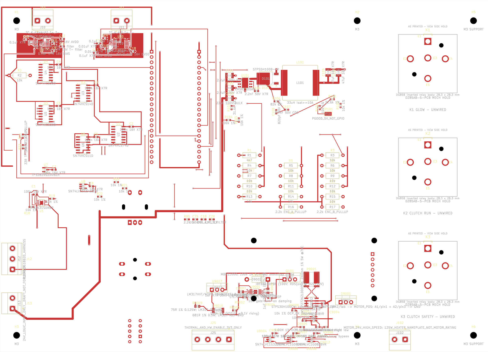
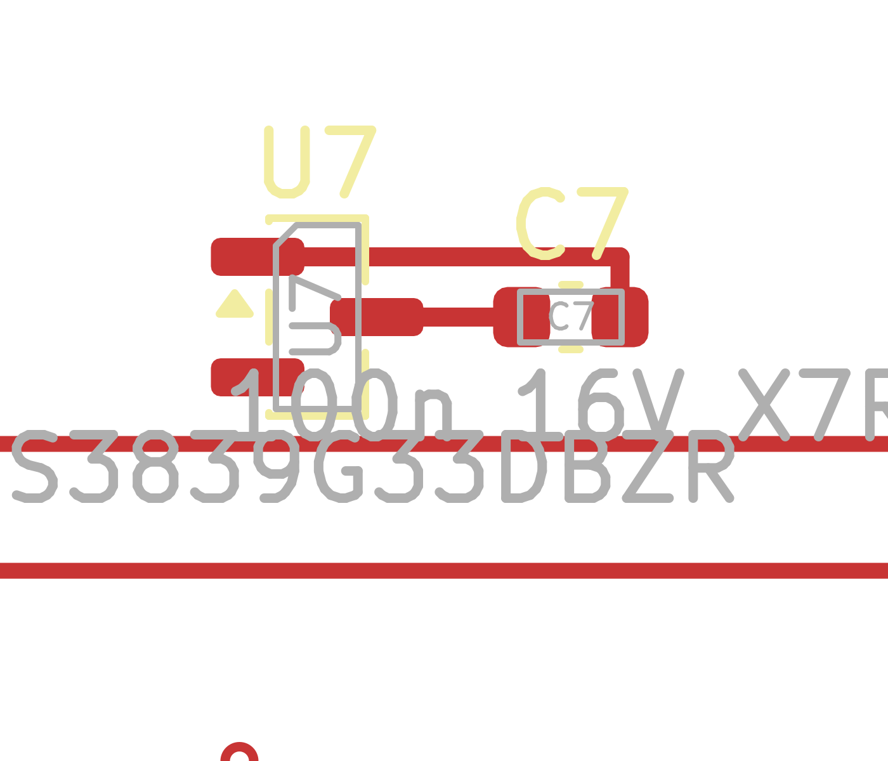

# U7/C7: местная медь, снимок 115e8ed2

**DRAFT / NOT FOR ORDER / NO FIRE. HOLD: дальнейшая общая разводка и интеграция прошивки запрещены до исправления TFT keepout и повторной инженерной приёмки.** [Исправление прежней приёмки](../../../docs/TFT_KEEPOUT_ERRATUM_RU.md) имеет приоритет над исходным отчётом и README снимка d015fbb1. Защита крепежа TFT не принята; этот снимок сохраняет известный дефект, а не исправляет его.

## Что сохранено

[PCB](Sirokko26201_control_motor_candidate.kicad_pcb) выгружена с Lab без редактирования. SHA256 источника до/после контрольного чтения и копии совпали: `115e8ed2d2929598fa6529c871c49247c11173040c0df65da872fd5922b8aeec`. Исходная неизменённая [база d015fbb1](../panel_v2_req029_yd_d015fbb1/README_RU.md) сохранена отдельно. [Контрольные суммы](SHA256SUMS.txt) относятся только к этому новому каталогу.

Инженер ранее добавил ровно три сегмента F.Cu шириной 0.30 мм:

- `/+3V3`: `(32.9375;92)` → `(35.225;92)` мм, местная связь U7.3↔C7.1;
- `/GND`: `(31.0625;91.05)` → `(36.775;91.05)` → `(36.775;92)` мм, местная связь U7.1↔C7.2.

Это **не завершение питания U7/C7**: обе местные группы всё ещё не подведены к основным +3V3/GND. Плата содержит 753 сегмента и 179 переходов. Издатель CAD не редактировал, зоны не переносил и правила не менял.

## Фактические проверки

- [NATIVE_AUDIT.json](NATIVE_AUDIT.json): KiCad `10.0.7-10.0.7~ubuntu26.04.1`, `BOARD.BuildConnectivity` и `CONNECTIVITY_DATA.GetConnectedItems`; отдельный физический поиск с `IGNORE_NETS` не скрывает контакты разных сетей.
- Сохранены все 475 площадок с UUID/геометрией/сетями, все 929 прежних объектов дорожек/переходов и все прежние связи между 5381 парой площадок. Добавлены ровно две целевые связанные пары; всего 5383. Потерянных связанных пар и межсетевых замыканий нет. Файлы до/после штатного чтения имеют те же SHA256.
- [Полный исходный DRC](FINAL_DRC.json): 82 незавершённых соединения severity=error, те же 10 предупреждений (2 `lib_footprint_mismatch`, 8 `track_dangling`) и 5 прежних исключённых проверок. Списки предупреждений, исключений и включённые уровни проверок совпали с d015fbb1. Это не общий PASS и не новая проверка схемного соответствия.
- [BEFORE_DRC.json](BEFORE_DRC.json), [AFTER_DRC.json](AFTER_DRC.json), [ROUTING_READBACK.json](ROUTING_READBACK.json) — неизменённые результаты координатора. Изменившиеся представители воздушных связей не приравниваются к разрушению связанных групп; группы проверены штатным движком отдельно.
- [TFT_KEEPOUT_READBACK.json](TFT_KEEPOUT_READBACK.json): четыре области остались на старых центрах, охват новых центров MH5 — **0/4 даже по ограничивающим прямоугольникам**. Подробности и обязательный HOLD — в [исправлении приёмки](../../../docs/TFT_KEEPOUT_ERRATUM_RU.md).
- [PUBLICATION_CHECKS.json](PUBLICATION_CHECKS.json) фиксирует сравнение DRC, геометрию дефекта и SHA источника/копии. Издатель не перезапускал полный DRC и не перезаливал зоны; опубликован свежий полный отчёт координатора.
- Штатный `pcbnew` при импорте выдал три `PROPERTY_ENUM(): No enum choices defined` assertion; при повторном открытии также были сообщения wx о повторных обработчиках изображений. Полный [stderr](NATIVE_STDERR.txt) сохранён, сообщения не подавлялись, сервер не исправлялся. Сам вызов BuildConnectivity и проверки завершились успешно; безошибочная инициализация KiCad не заявляется.

Повторить проверку связности в среде с тем же штатным `pcbnew`:

```sh
python3 NATIVE_AUDIT.py \
  ../panel_v2_req029_yd_d015fbb1/Sirokko26201_control_motor_candidate.kicad_pcb \
  Sirokko26201_control_motor_candidate.kicad_pcb
sha256sum -c SHA256SUMS.txt
```

## Изображения

**DRAFT / NOT FOR ORDER / NO FIRE.** [Полный F.Cu SVG](F_CU_DRAFT.svg) получен штатным `kicad-cli pcb export svg` из точной PCB 115e8ed2 с F.Cu/F.Silkscreen/F.Fab/Edge.Cuts, без изменения платы и без перезаливки. [PNG](F_CU_DRAFT.png) отрисован из этого SVG; [увеличенный фрагмент U7/C7](F_CU_U7_C7_DETAIL_DRAFT.png) — другой viewBox того же экспорта, не нарисованная заново медь.

Общий вид и увеличенный фрагмент открыты и осмотрены: плата показана полностью, U7/C7 и оба новых пути видны целиком. Перекрытия служебных надписей сохранены; в увеличенном фрагменте обрезаны соседние объекты и часть текста, не целевые площадки/дорожки. По растру электрическая или механическая приёмка не заявляется.





K1/K2/K3 UNWIRED, питание YD, RESET F-side NO/NC, высоты и прочие ранее указанные ограничения остаются открытыми. Сторонние PDF/модели не включены. Изготовление, запись устройства, подключение опасных нагрузок/топлива и огневые испытания запрещены.
